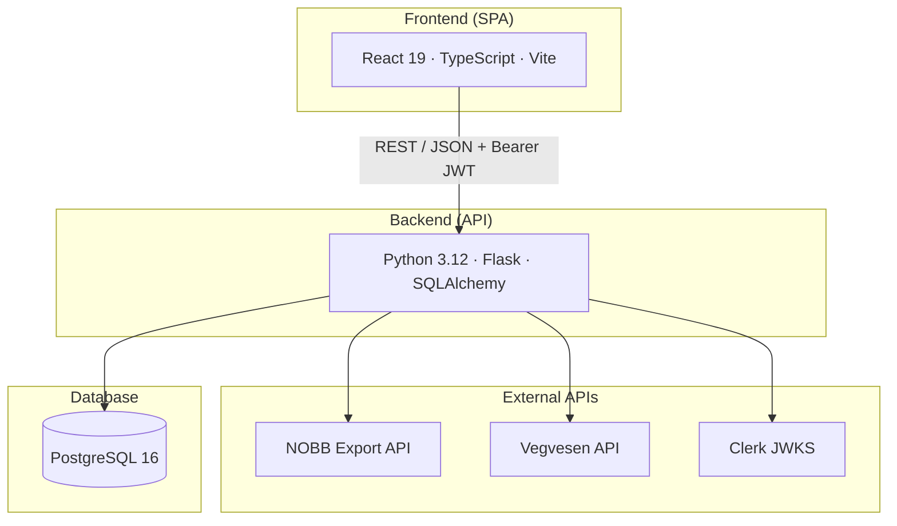

**Home** | [Setup Guide](docs/setup.md) | [Architecture](docs/architecture.md) | [Backend](docs/backend.md) | [Frontend](docs/frontend.md) | [Testing](docs/testing.md) | [Security](docs/security.md) | [Deployment](docs/deployment.md) | [Development](docs/development.md)

---

# Byggspor

Construction CO₂ footprint calculator for Norwegian building projects. Upload material invoices and transport reports, enrich them with environmental data from national APIs, and get a per-project emissions breakdown across four categories: **materials**, **transport**, **energy**, and **waste**.

## Documentation

| Document | Description |
|----------|-------------|
| [Setup Guide](docs/setup.md) | Prerequisites, environment variables, database, backend, frontend, pre-commit hooks |
| [Architecture](docs/architecture.md) | System overview, tech stack, data model, external API integrations, data flow |
| [Backend](docs/backend.md) | API endpoints, services, database models, migrations |
| [Frontend](docs/frontend.md) | Feature modules, components, hooks, routing, UI patterns |
| [Testing](docs/testing.md) | Test infrastructure, test suites, CI pipeline, coverage gaps |
| [Security](docs/security.md) | Authentication flow, RBAC, secrets management, known limitations |
| [Deployment](docs/deployment.md) | Vercel (frontend), OCI VM (backend), Caddy, DNS, production readiness |
| [Development](docs/development.md) | Branching, PRs, commit conventions, linting, code quality tools |

## Tech Stack

| Layer | Technology |
|-------|-----------|
| Frontend | React 19, TypeScript 5.9, Vite 7, Tailwind CSS 4, shadcn/ui |
| Auth (client) | Clerk React SDK |
| Server state | TanStack Query |
| Routing | React Router 7 |
| Backend | Python 3.12, Flask, Gunicorn, SQLAlchemy 2.0, Alembic |
| Auth (server) | PyJWT + Clerk JWKS |
| Database | PostgreSQL 16 (Docker Compose) |
| CI | GitHub Actions |
| Deployment | Vercel (frontend), OCI VM + Caddy (backend) |

## Architecture



Users upload **EHF invoices** (XML) to look up construction materials via the NOBB API and calculate CO₂ from EPD data. **Transport reports** (Abax XML) are enriched with vehicle emission data from the Vegvesen API. **Energy** consumption is entered manually and calculated using NVE's national grid emission factor. All data feeds into per-project KPI dashboards with confidence scores.

See [Architecture](docs/architecture.md) for the full breakdown.

## Quick Start

```bash
# Clone and configure
git clone <repo-url>
cd byggspor
cp .env.example .env          # fill in API credentials

# Database setup (first time only)
docker compose up -d
cd backend
python3 -m venv venv
source venv/bin/activate
pip install -r requirements.txt
alembic upgrade head           # create all tables
cd ..

# Start everything
pnpm run dev
```

This starts PostgreSQL (Docker), the backend (Flask on port 5000), and the frontend (Vite on port 5173) concurrently.

For the step-by-step manual setup, see the [Setup Guide](docs/setup.md).

| Service | URL |
|---------|-----|
| Frontend | http://localhost:5173 |
| Backend | http://localhost:5000/health |
| Database | localhost:5432 |

## Project Structure

```
byggspor/
├── frontend/                # React SPA
│   └── src/
│       ├── app/             # App shell, routes
│       ├── components/ui/   # shadcn/ui primitives
│       ├── features/        # Feature modules (auth, dashboard, invoice, transport, energy, ...)
│       ├── shared/          # API client, hooks, context, types
│       └── lib/             # Utilities
│
├── backend/                 # Flask REST API
│   ├── app/
│   │   ├── middleware/      # Auth (Clerk JWT), RBAC decorators
│   │   ├── models/          # SQLAlchemy models (16)
│   │   ├── routes/          # Flask blueprints (8)
│   │   └── services/        # Business logic, external API clients (9)
│   ├── alembic/             # Database migrations
│   └── tests/               # pytest suite
│
├── docs/                    # Documentation
├── docker-compose.yml       # PostgreSQL
└── .github/workflows/       # CI pipeline
```

## CO₂ Categories

| Category | Data Source | Calculation |
|----------|-----------|-------------|
| Materials | EHF invoices (XML) | NOBB → EPD → GWP per unit × quantity |
| Transport | Abax reports (XML) or manual | Vehicle CO₂/km (Vegvesen) × distance |
| Energy | Manual kWh entry | kWh × 0.0119 kg CO₂eq (NVE national average) |
| Waste | Manual entry | Waste type × quantity (planned) |

## Development Workflow

- **Branching:** Feature branches off `main`, no dev/staging branch ([why](docs/development.md#branching-strategy))
- **PRs:** One approval required, author merges, CI must pass
- **CI:** GitHub Actions runs lint + format + test + build on every PR
- **Pre-commit hooks:** Ruff (backend), ESLint + Prettier (frontend), branch protection
- **Commits:** Category prefix encouraged (`feat:`, `fix:`, `ui:`, `chore:`, etc.)

See [Development](docs/development.md) for full details.

## Deployment

| Component | Hosting |
|-----------|---------|
| Frontend | [Vercel](https://vercel.com/) — auto-deploys on push |
| Backend | OCI VM (Ubuntu 24) — auto-deploys on push (systemd timer), Gunicorn + Caddy reverse proxy with auto TLS |
| Database | PostgreSQL 16 in Docker on the same VM |
| DNS | Cloudflare |

See [Deployment](docs/deployment.md) for the full setup and production readiness issues.

## Running Tests

```bash
# Backend
cd backend && source venv/bin/activate
pytest

# Frontend
cd frontend
pnpm test
```

No external services or credentials needed — backend tests use in-memory SQLite and mock all APIs. See [Testing](docs/testing.md).

---

**Home** | [Setup Guide](docs/setup.md) | [Architecture](docs/architecture.md) | [Backend](docs/backend.md) | [Frontend](docs/frontend.md) | [Testing](docs/testing.md) | [Security](docs/security.md) | [Deployment](docs/deployment.md) | [Development](docs/development.md)
