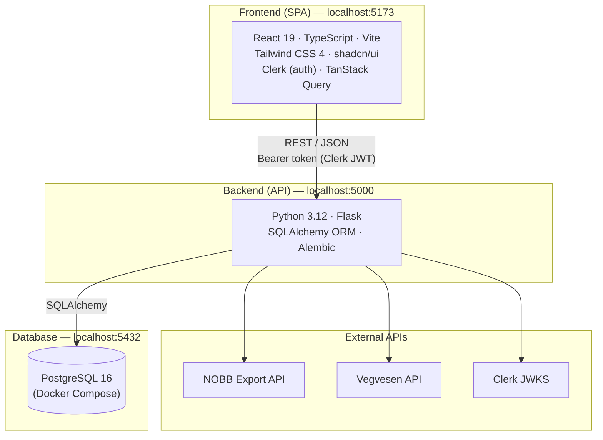

[Home](../README.md) | [Setup Guide](setup.md) | **Architecture** | [Backend](backend.md) | [Frontend](frontend.md) | [Testing](testing.md) | [Security](security.md) | [Deployment](deployment.md) | [Development](development.md)

---

# Architecture

Byggspor is a construction CO₂ footprint calculator built as a client-server web application. Users upload invoices and transport reports, the system enriches them with environmental data from external APIs, and the result is a per-project emissions breakdown across four categories: **materials**, **transport**, **energy**, and **waste**.

## High-Level Overview



## Tech Stack

| Layer | Technology | Purpose |
|-------|-----------|---------|
| Frontend | React 19 + TypeScript | UI framework |
| Bundler | Vite 7 | Dev server and build tool |
| Styling | Tailwind CSS 4 + shadcn/ui | Utility-first CSS with component primitives |
| Auth (client) | Clerk React SDK | Sign-in/sign-up, JWT token management |
| Server state | TanStack Query | Data fetching, caching, mutation management |
| Routing | React Router 7 | Client-side page routing |
| Backend | Flask (Python 3.12) | REST API server |
| ORM | SQLAlchemy 2.0 | Database models and queries |
| Migrations | Alembic | Schema versioning |
| Database | PostgreSQL 16 | Primary data store (Docker Compose) |
| Auth (server) | PyJWT + Clerk JWKS | JWT verification |
| CI | GitHub Actions | Lint, format, test, build on every PR |

## Project Structure

```
byggspor/
├── frontend/
│   └── src/
│       ├── app/                    # App shell, routes, root component
│       ├── components/ui/          # shadcn/ui primitives (Button, Dialog, etc.)
│       ├── features/               # Feature modules (see below)
│       ├── shared/                 # Cross-cutting: API client, hooks, context, types
│       ├── lib/                    # General utilities
│       └── test/                   # Test setup
│
├── backend/
│   ├── app/
│   │   ├── main.py                # Flask app factory, blueprint registration
│   │   ├── database.py            # SQLAlchemy engine and session
│   │   ├── middleware/             # Auth (Clerk JWT) and role-checking decorators
│   │   ├── models/                # SQLAlchemy ORM models (16 models)
│   │   ├── routes/                # Flask blueprints (8 route modules)
│   │   └── services/              # Business logic and external API clients
│   ├── alembic/                   # Database migration files
│   └── tests/                     # pytest test suite
│
├── docs/                          # Documentation (you are here)
├── scripts/                       # Utility scripts (NOBB lookup demo)
├── context/                       # Project context files
├── docker-compose.yml             # PostgreSQL service
└── .github/workflows/ci.yml       # CI pipeline
```

## Frontend Architecture

### Feature-Based Module Structure

The frontend is organized by **feature modules** rather than by file type. Each feature encapsulates its own components, hooks, API calls, and types:

```
features/
├── auth/           # Clerk sign-in/sign-up, route protection
├── dashboard/      # Global dashboard, project dashboard, KPI cards, CO₂ summary
├── energy/         # Energy consumption input and display
├── invoice/        # EHF invoice upload, parsing, material table, CO₂ display
├── onboarding/     # New user onboarding flow
├── organization/   # Organization settings, member management
├── project/        # Project CRUD, project hooks
├── settings/       # App settings page
├── transport/      # Transport report upload (Abax XML), manual input, trip table
└── user/           # User profile
```

### Key Patterns

- **API client** ([shared/api/client.ts](../frontend/src/shared/api/client.ts)): A thin `fetch` wrapper (`apiRequest` and `postFile`) that handles JSON serialization, Bearer token injection, and error extraction. All feature API modules build on this.
- **TanStack Query**: Server state is managed through `useQuery` and `useMutation` hooks. The query client is configured with a 30-second stale time and no refetch-on-focus.
- **AppContext**: Provides the current `organizationId` and organization data to all authenticated components via React Context.
- **Protected routes**: The `ProtectedRoute` component wraps all authenticated pages, redirecting unauthenticated users to `/sign-in`.

### Route Map

| Path | Component | Description |
|------|-----------|-------------|
| `/sign-in/*` | AuthLayout | Clerk sign-in |
| `/sign-up/*` | AuthLayout | Clerk sign-up |
| `/onboarding` | OnboardingPage | New user setup |
| `/` | GlobalDashboard | All projects overview with KPI cards |
| `/projects/:projectId` | ProjectDashboard | Single project with tabbed data entry |
| `/profile` | UserProfile | User profile settings |
| `/organization` | OrgSettings | Org members and settings |
| `/settings` | SettingsPage | Application settings |

## Backend Architecture

### Request Lifecycle

Every request passes through this pipeline:

1. **`open_session`** — Creates a request-scoped SQLAlchemy database session (`g.db`)
2. **`run_authentication`** — Verifies the Clerk JWT, syncs the user to the local DB, sets `g.current_user` and `g.current_user_id`. Public paths (`/health`) skip this.
3. **Route handler** — The matching blueprint handles the request
4. **`close_session`** — Closes the DB session, rolling back on error

### Blueprint Organization

The API is split into 8 Flask blueprints:

| Blueprint | Prefix | Responsibility |
|-----------|--------|---------------|
| `user_bp` | `/users` | User profile, current user info |
| `organization_bp` | `/organizations` | Org CRUD, member management |
| `project_bp` | `/projects` | Project CRUD, membership |
| `invoice_bp` | `/invoices` | EHF invoice upload and parsing |
| `nobb_bp` | `/nobb` | NOBB product lookup |
| `energy_bp` | `/energy` | Energy consumption entries |
| `transport_bp` | `/transport` | Transport report upload and trips |
| `report_bp` | `/report` | CO₂ summary and report generation |

### Services Layer

Business logic is separated from route handlers into service modules:

| Service | Purpose |
|---------|---------|
| `nobb_client.py` | NOBB Export API client — product search, detail fetch, EPD/GWP extraction |
| `vegvesen_client.py` | Statens vegvesen API — vehicle lookup by registration number, CO₂/km extraction |
| `ehf_parser.py` | Parses EHF (Electronic Handelsformat) XML invoices into structured line items |
| `transport_parser.py` | Parses Abax Turrapport XML into individual transport trips |
| `material_service.py` | Material enrichment — NOBB lookup, CO₂ calculation, caching |
| `transport_service.py` | Transport enrichment — vehicle lookup, emission calculation |
| `invoice_enrichment.py` | Enriches parsed invoice data with CO₂ values from NOBB/EPD lookups |
| `vehicle_lookup.py` | Vehicle data lookup and caching logic |
| `user_sync.py` | Syncs Clerk user claims to local User model on first login |

### Role-Based Access Control

Two levels of RBAC enforced via middleware decorators:

**Organization roles** (`OrgRole`): `OWNER`, `ADMIN`, `MEMBER`, `VIEWER`
- Checked via `@require_org_role(...)` decorator
- System admins bypass all org role checks

**Project roles** (`ProjectRole`): `OWNER`, `EDITOR`, `VIEWER`
- Checked via `@require_project_role(...)` decorator
- Project creators are automatically added as `OWNER`
- System admins bypass all project role checks

## Data Model

### Entity Relationship Overview

The data model has three layers:

**1. Identity & Access** — Users, Organizations, and their memberships
```
User ──┬── OrganizationMember ──── Organization
       └── ProjectMember ────────── Project
```

**2. Shared Catalogs** — Cached data from external APIs (not owned by any project)
```
Material        (NOBB product cache — one record per GTIN/NOBB number)
Vehicle         (Vegvesen vehicle cache — one record per registration number)
MaterialInvoice (source metadata for uploaded EHF files)
TransportReport (source metadata for uploaded Abax XML files)
WasteInvoice    (source metadata for uploaded waste reports)
```

**3. Project Data** — Per-project records linking to catalogs and sources
```
Project ──┬── ProjectMaterial   → Material + MaterialInvoice
          ├── ProjectTransport  → Vehicle + TransportReport
          ├── ProjectWasteItem  → WasteInvoice
          ├── Energy
          └── GeneratedInvoice
```

### CO₂ Calculation Categories

Each project tracks emissions across four categories:

| Category | Data Source | CO₂ Calculation |
|----------|-----------|-----------------|
| **Materials** | EHF invoices (XML) | NOBB lookup → EPD → GWP per unit × quantity |
| **Transport** | Abax trip reports (XML) or manual entry | Vehicle CO₂/km (Vegvesen API) × distance |
| **Energy** | Manual entry | kWh × national grid emission factor (single value for all of Norway; price zone stored for future use) |
| **Waste** | Waste reports or manual entry | Report-provided or calculated from waste type × quantity |

### Confidence Scores

Most project data records include a `confidence_score` (integer) indicating how reliable the CO₂ estimate is. This propagates up to the `GeneratedInvoice` as an `overall_confidence_score`. The frontend displays these as confidence gauges on the dashboard KPI cards.

## External API Integrations

### NOBB Export API

- **Purpose**: Look up construction materials by GTIN or NOBB number
- **Data returned**: Product name, product group, EPD (Environmental Product Declaration) with GWP (Global Warming Potential) data broken down by lifecycle stages (A1-A3, etc.)
- **Auth**: Username/password (`NOBB_API_USERNAME`, `NOBB_API_PASSWORD`)
- **Retry**: 3 retries with backoff on 429/5xx

### Statens vegvesen (SVV) API

- **Purpose**: Look up vehicle technical data by registration number
- **Data returned**: Vehicle type, make, model, fuel type, CO₂ emissions per km (WLTP preferred, NEDC fallback)
- **Auth**: API key (`SVV_API_KEY`) via `SVV-Authorization` header
- **Retry**: 3 retries with backoff on 429/5xx

### Clerk

- **Purpose**: User authentication and identity
- **Flow**: Frontend obtains JWT from Clerk → sends as Bearer token → backend verifies against Clerk's JWKS endpoint → syncs user to local DB
- **Config**: `CLERK_ISSUER`, `CLERK_JWKS_URL` (optional), `CLERK_JWT_AUDIENCE` (optional)

## Data Flow: Invoice Upload Example

This illustrates how the key pieces connect end-to-end:

```
1. User uploads EHF XML file in ProjectDashboard
2. Frontend sends file via postFile() → POST /invoices/parse
3. Backend ehf_parser.py extracts line items (GTIN, quantity, price)
4. Backend material_service.py looks up each GTIN via nobb_client.py
5. NOBB API returns product info + EPD/GWP data
6. Backend calculates CO₂ per line item (GWP × quantity)
7. Results cached in Material table, linked via ProjectMaterial
8. Response returned to frontend with enriched line items
9. Frontend displays InvoiceTable with CO₂ values and confidence scores
10. CO₂ totals aggregated in KPI cards on dashboard
```

---

[Home](../README.md) | [Setup Guide](setup.md) | **Architecture** | [Backend](backend.md) | [Frontend](frontend.md) | [Testing](testing.md) | [Security](security.md) | [Deployment](deployment.md) | [Development](development.md)
