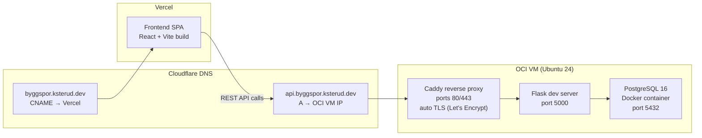

[Home](../README.md) | [Setup Guide](setup.md) | [Architecture](architecture.md) | [Backend](backend.md) | [Frontend](frontend.md) | [Testing](testing.md) | [Security](security.md) | **Deployment** | [Development](development.md)

---

# Deployment

## Overview

| Component | Hosting | URL |
|-----------|---------|-----|
| Frontend | Vercel | `https://byggspor.ksterud.dev` |
| Backend (API) | OCI VM (Ubuntu 24) | `https://api.byggspor.ksterud.dev` |
| Database | Docker on OCI VM | `localhost:5432` (not exposed) |
| DNS | Cloudflare | — |
| Auth | Clerk (hosted) | — |



## Frontend (Vercel)

### How It Works

The frontend is deployed on [Vercel](https://vercel.com/) as a static SPA. Vercel auto-builds and deploys on push.

**Build process:**
1. Vercel detects the `frontend/` directory
2. Runs `pnpm install` and `pnpm build` (Vite produces static assets in `dist/`)
3. Serves the built files from Vercel's edge network

**SPA routing:** The `vercel.json` configuration rewrites all paths to `index.html`, so React Router handles client-side routing:

```json
{
  "rewrites": [{ "source": "/(.*)", "destination": "/index.html" }]
}
```

### DNS

`byggspor.ksterud.dev` is a **CNAME** record in Cloudflare pointing to Vercel. Vercel handles TLS termination and provides an SSL certificate automatically.

### Environment Variables

Set in the Vercel project dashboard (not committed to the repo):

| Variable | Purpose |
|----------|---------|
| `VITE_CLERK_PUBLISHABLE_KEY` | Clerk frontend SDK key |
| `VITE_API_URL` | Backend API URL (`https://api.byggspor.ksterud.dev`) |

## Backend (OCI VM)

### Infrastructure

The backend runs on a personal Oracle Cloud Infrastructure (OCI) VM:

- **OS:** Ubuntu 24.04
- **Reverse proxy:** Caddy (automatic TLS via Let's Encrypt)
- **Services:** Flask API + PostgreSQL (Docker)
- **Code:** Cloned directly from the repository — same codebase as development

### Current Setup

The backend currently runs using Flask's built-in development server:

```bash
# On the VM
cd byggspor/backend
source venv/bin/activate
flask --app app.main run --debug
```

PostgreSQL runs via the same `docker-compose.yml` used in development:

```bash
# On the VM
cd byggspor
docker compose up -d
```

### Reverse Proxy (Caddy)

[Caddy](https://caddyserver.com/) runs as a systemd service on the VM, configured via `/etc/caddy/Caddyfile`. It provides:
- **Automatic TLS** — Obtains and renews Let's Encrypt certificates for `api.byggspor.ksterud.dev` automatically via ACME
- **Reverse proxy** — Forwards HTTPS traffic on ports 80/443 to Flask on `127.0.0.1:5000`
- **HTTP → HTTPS redirect** — Automatic

Caddy is managed via systemd:

```bash
sudo systemctl status caddy     # Check status
sudo systemctl restart caddy    # Restart after config changes
sudo journalctl -u caddy -f     # View logs
```

### DNS

`api.byggspor.ksterud.dev` is an **A** record in Cloudflare pointing to the OCI VM's public IP. Cloudflare proxy is **OFF** (DNS-only mode) — this is correct because Caddy handles TLS termination directly on the VM. Turning on Cloudflare proxy would cause a double-proxy setup and potentially interfere with Caddy's ACME certificate renewal.

### Environment Variables

Set in the `.env` file on the VM:

| Variable | Purpose |
|----------|---------|
| `DATABASE_URL` | PostgreSQL connection string |
| `NOBB_API_USERNAME` | NOBB API credentials |
| `NOBB_API_PASSWORD` | NOBB API credentials |
| `SVV_API_KEY` | Vegvesen API key |
| `CLERK_ISSUER` | Clerk JWT issuer URL |
| `CLERK_JWT_AUDIENCE` | Clerk JWT audience (optional) |
| `CLERK_JWKS_URL` | Clerk JWKS endpoint override (optional) |

### Database Migrations

After pulling new code with model changes:

```bash
cd byggspor/backend
source venv/bin/activate
alembic upgrade head
```

## CI Pipeline

GitHub Actions runs on every pull request to `main` and `development`. See [Testing](testing.md) for the full pipeline. Both frontend and backend jobs must pass before merging.

There is **no CD pipeline** — deployment is manual (see Deployment Process below).

## Deployment Process

### Frontend

Vercel auto-deploys when changes are pushed/merged. No manual steps required.

### Backend

Manual process on the OCI VM:

```bash
# SSH into the VM
ssh <vm-user>@<vm-ip>

# Pull latest code
cd byggspor
git pull

# Update dependencies (if requirements.txt changed)
cd backend
source venv/bin/activate
pip install -r requirements.txt

# Run migrations (if models changed)
alembic upgrade head

# Restart the Flask server
# (currently manual — kill the existing process and restart)
flask --app app.main run --debug
```

### Database

PostgreSQL runs as a Docker container. Data is persisted in a Docker volume (`pgdata`), so the container can be recreated without data loss:

```bash
docker compose up -d      # Start/restart
docker compose down        # Stop (data preserved)
docker compose down -v     # Stop and DELETE all data
```

## Production Readiness Issues

The current deployment works for development and demo purposes but has several issues that must be addressed before real production use.

### Flask Development Server

The backend runs Flask's built-in development server, which is [explicitly not designed for production](https://flask.palletsprojects.com/en/stable/deploying/). Issues:
- Single-threaded — can only handle one request at a time
- No process management — crashes require manual restart
- Debug mode exposes detailed tracebacks to clients

**Fix:** Use a WSGI server like Gunicorn:

```bash
pip install gunicorn
gunicorn -w 4 -b 0.0.0.0:5000 app.main:app
```

Combined with a systemd service for automatic restart:

```ini
# /etc/systemd/system/byggspor-api.service
[Unit]
Description=Byggspor Flask API
After=network.target docker.service

[Service]
User=<vm-user>
WorkingDirectory=/home/<vm-user>/byggspor/backend
Environment="PATH=/home/<vm-user>/byggspor/backend/venv/bin"
EnvironmentFile=/home/<vm-user>/byggspor/.env
ExecStart=/home/<vm-user>/byggspor/backend/venv/bin/gunicorn -w 4 -b 0.0.0.0:5000 app.main:app
Restart=always

[Install]
WantedBy=multi-user.target
```

### No Automated Deployment

Backend deploys are fully manual (SSH → git pull → restart). A deployment script or CI/CD pipeline would reduce human error and downtime. At minimum, a shell script that automates the pull-migrate-restart flow.

### Clerk Development Mode

The application uses Clerk's **development instance** (`suitable-dassie-90.clerk.accounts.dev`) in all environments, including the deployed VM. Clerk development instances:
- Display a "Development mode" banner
- Have relaxed security defaults
- Are not intended for production use
- May have different rate limits and SLAs than production instances

Before real production use, create a Clerk production instance and update `CLERK_ISSUER`, `CLERK_JWKS_URL`, and `VITE_CLERK_PUBLISHABLE_KEY` in both the VM `.env` and Vercel environment variables.

### Database Credentials

PostgreSQL uses the default `postgres:postgres` credentials from `docker-compose.yml`. These should be changed to non-default values in production, even though the database port is not exposed publicly.

### CORS

The backend allows all origins (`CORS(app)` with no restrictions). In production, this should be restricted to the frontend origin:

```python
CORS(app, origins=["https://byggspor.ksterud.dev"])
```

### Debug Logging

The auth middleware prints authorization headers to stdout (see [Security](security.md)). This must be removed before production.

---

[Home](../README.md) | [Setup Guide](setup.md) | [Architecture](architecture.md) | [Backend](backend.md) | [Frontend](frontend.md) | [Testing](testing.md) | [Security](security.md) | **Deployment** | [Development](development.md)
