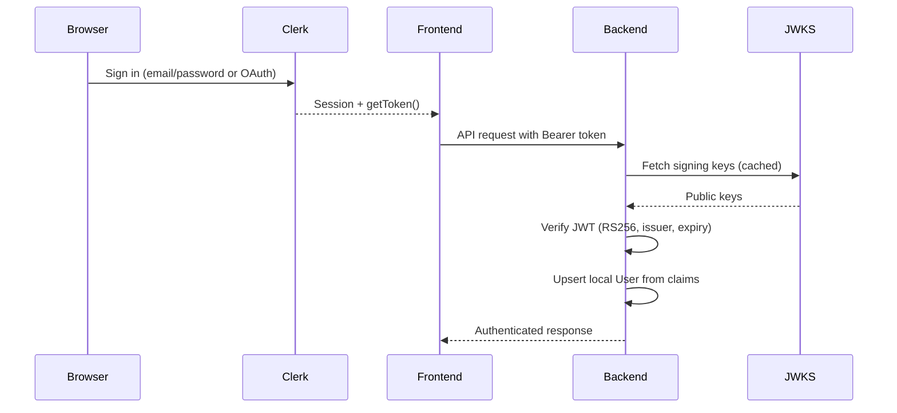

[Home](../README.md) | [Setup Guide](setup.md) | [Architecture](architecture.md) | [Backend](backend.md) | [Frontend](frontend.md) | [Testing](testing.md) | **Security** | [Deployment](deployment.md) | [Development](development.md)

---

# Security

## Overview

Byggspor delegates identity management to [Clerk](https://clerk.com/) and layers its own role-based access control on top. The security model has three parts:

1. **Authentication**: Clerk issues JWTs on the frontend; the backend verifies them against Clerk's JWKS endpoint on every request
2. **Authorization**: Two tiers of RBAC (organization roles and project roles) enforced via middleware decorators
3. **Secrets management**: All credentials live in environment variables, never in source control

## Authentication Flow



### Frontend (Clerk React SDK)

The frontend uses Clerk's React SDK for all identity operations:

- **`ClerkProvider`** wraps the app in `App.tsx`, configured with `VITE_CLERK_PUBLISHABLE_KEY`
- **`useAuth()`** provides `isSignedIn`, `getToken()`, and session state
- **`ProtectedRoute`** gates all authenticated pages:
  1. Waits for Clerk to initialize (`isLoaded`)
  2. Redirects unauthenticated users to `/sign-in`
  3. Calls `/users/me` to sync the user profile and get the `organization_id`
  4. Fetches organization data and provides it via `AppContext`
  5. Redirects users without an organization to `/onboarding`
- **`useRequireToken()`** is a shared hook that wraps `getToken()` with an error throw if auth is missing. Used by feature hooks before making API calls
- **`apiRequest()` and `postFile()`** automatically attach `Authorization: Bearer <token>` headers when a token is provided

### Backend (JWT Verification)

Every request passes through the `authenticate_request` middleware registered as a `@app.before_request` handler.

**Pipeline:**

1. **Skip check**: CORS preflight (`OPTIONS`) and explicitly public paths (`/health`) pass through without a token
2. **Extract token**: Reads the `Authorization: Bearer <token>` header
3. **Verify JWT**: Validates the token using Clerk's JWKS public keys:
   - Algorithm: `RS256`
   - Issuer: must match `CLERK_ISSUER`
   - Audience: verified only if `CLERK_JWT_AUDIENCE` is set
   - Expiry: checked with 60-second leeway
   - Subject (`sub`): must be present
4. **Sync user**: Calls `upsert_user_from_clerk()` to create or update the local `User` record from the JWT claims
5. **Set request context**: Populates `g.current_user`, `g.current_user_id`, and `g.clerk_claims`

**Error responses:**

| Condition | Status | Body |
|-----------|--------|------|
| Missing or malformed token | 401 | `{"error": "Unauthorized"}` |
| Expired token | 401 | `{"error": "Token expired"}` |
| Invalid token (bad signature, wrong issuer) | 401 | `{"error": "Invalid token"}` |
| Missing `CLERK_ISSUER` env var | 500 | `{"error": "Missing CLERK_ISSUER"}` |
| User sync failure | 500 | `{"error": "Failed to sync authenticated user"}` |

**JWKS caching:** The `PyJWKClient` is created once via `@lru_cache(maxsize=1)` and reused for all subsequent requests. This avoids fetching the JWKS endpoint on every request while still supporting key rotation (PyJWKClient handles cache invalidation internally).

### User Sync (`user_sync.py`)

On every authenticated request, the backend ensures the Clerk identity is linked to a local `User` record:

1. **Lookup by `clerk_id`**: Finds the existing user linked to this Clerk account
2. **Legacy link by email**: If no `clerk_id` match, looks for a user with the same email and no `clerk_id` (pre-Clerk accounts)
3. **Update**: Keeps `clerk_id` and `email` in sync with Clerk; preserves locally-set profile name
4. **Create**: Seeds a new user record from Clerk claims (`sub`, `email`, `name`/`given_name`+`family_name`)

New users are created with `is_system_admin = False`. System admin status can only be set by an existing system admin via `PATCH /users/<id>`.

## Authorization (RBAC)

### Public vs. Protected Paths

| Path | Access |
|------|--------|
| `/health` | Public, no token required |
| `OPTIONS` (any path) | Public, CORS preflight always passes |
| Everything else | Requires valid Clerk JWT |

There are no anonymous-access endpoints beyond `/health`.

### Organization Roles

| Role | Permissions |
|------|------------|
| `OWNER` | Full control: update org, manage members, all data operations |
| `ADMIN` | Same as OWNER (update org, manage members) |
| `MEMBER` | Access org data, create projects |
| `VIEWER` | Read-only access to org data |

Enforced by the `@require_org_role()` decorator on organization routes. The decorator:
1. Extracts `organization_id` from the route parameters
2. Looks up the user's `OrganizationMember` record
3. Returns 403 if the user's role is not in the allowed list

**Currently applied to:**
- `GET /organizations/<id>`: any org role
- `PATCH /organizations/<id>`: OWNER, ADMIN
- `GET /organizations/<id>/members`: OWNER, ADMIN
- `POST /organizations/<id>/members`: OWNER, ADMIN
- `DELETE /organizations/<id>/members/<user_id>`: OWNER, ADMIN

### Project Roles

| Role | Permissions |
|------|------------|
| `OWNER` | Full project control |
| `EDITOR` | Read and write project data |
| `VIEWER` | Read-only project access |

Enforced by the `@require_project_role()` decorator. Same pattern as org roles: extracts `project_id` from route parameters and checks membership.

Project creators are automatically assigned the `OWNER` role via a SQLAlchemy `after_insert` event on the `Project` model.

### System Admin Bypass

Users with `is_system_admin = True` bypass both organization and project role checks. The role-checking functions return `OWNER` for system admins without querying the membership tables:

```python
if user.is_system_admin:
    return OrgRole.OWNER  # Bypass org role checks
```

This allows system admins to access any organization or project regardless of membership.

### Authorization Gaps

Several routes currently rely only on authentication (valid JWT) without checking organization or project membership:

- **Invoice routes** (`/invoice/*`): No org/project role checks
- **Transport routes** (`/transport/*`): No org/project role checks
- **Energy routes** (`/energy/*`): No org/project role checks
- **Report routes** (`/report/*`): No org/project role checks
- **NOBB routes** (`/nobb/*`): No org/project role checks
- **Project routes** (`/projects/*`): Scoped to user's org via query filter, but no role decorator

These routes are protected by authentication (you must be signed in), but any authenticated user could theoretically access any project's data if they know the project ID. The org-scoping in project routes provides partial protection via query filtering, but the data routes (invoice, transport, energy) don't have equivalent scoping.

## Secrets Management

### Environment Variables

All secrets are stored in `.env` files that are excluded from version control:

| Secret | Variable | Used By |
|--------|----------|---------|
| Database credentials | `DATABASE_URL` | Backend (SQLAlchemy) |
| NOBB API credentials | `NOBB_API_USERNAME`, `NOBB_API_PASSWORD` | Backend (nobb_client.py) |
| Vegvesen API key | `SVV_API_KEY` | Backend (vegvesen_client.py) |
| Clerk issuer URL | `CLERK_ISSUER` | Backend (JWT verification) |
| Clerk JWT audience | `CLERK_JWT_AUDIENCE` | Backend (JWT verification, optional) |
| Clerk JWKS URL override | `CLERK_JWKS_URL` | Backend (JWT verification, optional) |
| Clerk publishable key | `VITE_CLERK_PUBLISHABLE_KEY` | Frontend (Clerk SDK) |

### Git Protection

The `.gitignore` excludes all environment files:

```
.env
.env.*
!.env.example
```

Only `.env.example` (with placeholder values and the shared dev Clerk instance) is committed. Actual secrets never enter the repository.

### Credential Handling in External API Clients

- **NOBB client**: Reads `NOBB_API_USERNAME` and `NOBB_API_PASSWORD` from environment on each session creation. Uses HTTP Basic Auth. Raises `RuntimeError` if credentials are missing.
- **Vegvesen client**: Reads `SVV_API_KEY` from environment. Sends as `SVV-Authorization: Apikey <key>` header. Raises `RuntimeError` if missing.
- **Clerk**: Backend reads `CLERK_ISSUER` from environment. Raises `RuntimeError` if missing. The JWKS URL is derived from the issuer unless overridden.

Both external API clients use `requests.Session` with retry logic (3 retries with backoff on 429/5xx status codes).

### Frontend Secrets

The only frontend credential is `VITE_CLERK_PUBLISHABLE_KEY`. This is a **publishable** key by design: it identifies the Clerk application but cannot be used to perform authenticated actions. Clerk's security model assumes publishable keys are visible in client-side code.

No other secrets are exposed to the frontend. The `VITE_API_URL` defaults to `http://localhost:5000` and is not a secret.

## CORS

CORS is configured in `main.py`:

```python
CORS(app)
```

This uses `flask-cors` with default settings, which means **all origins are allowed** (`Access-Control-Allow-Origin: *`). This is appropriate for local development but should be restricted to specific origins in production.

The `OPTIONS` preflight bypass in the auth middleware ensures CORS preflight requests are never blocked by authentication.

## Branch Protection

Pre-commit hooks block direct commits to protected branches:

```yaml
- id: no-commit-to-branch
  args: [--branch, main, --branch, development]
```

All changes to `main` and `development` must go through pull requests. GitHub Actions CI (lint, format, test, build) must pass before merging.

## Security Considerations

### Current Strengths

- **Delegated auth**: Clerk handles password storage, session management, and MFA. No password handling in application code.
- **JWT verification**: RS256 signature verification against JWKS with issuer and expiry checks. No shared secrets for token signing.
- **Secret isolation**: All credentials in environment variables, excluded from git.
- **User sync**: Local user records are derived from Clerk, not independently managed. No separate user registration.
- **Pre-commit hooks**: Automated linting, formatting, and branch protection on every commit.

### Known Limitations

- **CORS is wide open**: `CORS(app)` with no origin restrictions. Should be locked to the frontend origin in production.
- **Authorization gaps**: Most data routes lack org/project role enforcement (see Authorization Gaps above).
- **No rate limiting**: No rate limiting on any endpoint. The external API clients have retry logic but the backend itself has no request throttling.
- **No CSRF protection**: Relies on JWT Bearer tokens (not cookies) so traditional CSRF is not applicable, but there are no additional CSRF headers.
- **Debug logging**: `authenticate_request` prints the authorization header to stdout (`print("AUTH HEADER:", ...)`). This should be removed in production.
- **No input validation framework**: Request body validation is done ad-hoc in route handlers rather than through a schema validation library (e.g., Marshmallow, Pydantic).
- **Clerk development instance**: All environments (local and deployed) use a Clerk dev instance. Dev instances have relaxed security and are not suitable for production. See [Deployment](deployment.md) for details.

---

[Home](../README.md) | [Setup Guide](setup.md) | [Architecture](architecture.md) | [Backend](backend.md) | [Frontend](frontend.md) | [Testing](testing.md) | **Security** | [Deployment](deployment.md) | [Development](development.md)
